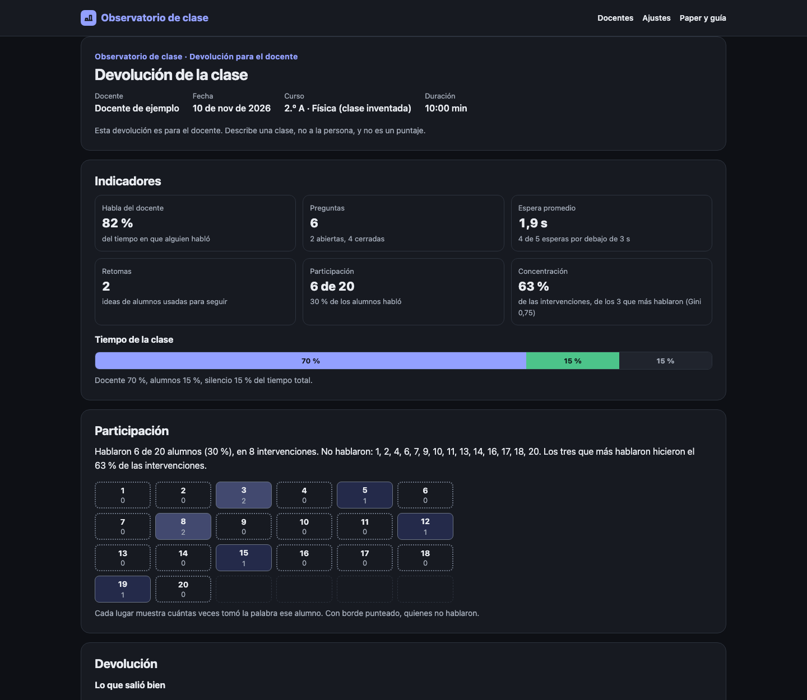

<div align="center">

# Classroom Observatory

**Observatorio de clase.** Para que una escuela chica observe clases y les dé a sus docentes una devolución: quién habla, qué se pregunta, cuánto se espera y quiénes participan. Una herramienta para mejorar, nunca un puntaje ni una sanción.

[**▶ Probala en vivo**](https://loiaconobruno.github.io/classroom-observatory/) · [**📄 Paper y guía**](https://loiaconobruno.github.io/classroom-observatory/guia.html) · [Cómo funciona](#cómo-funciona) · [IA opcional](#ia-opcional) · [Privacidad](#privacidad) · [Limitaciones](#limitaciones)

[](https://github.com/LoiaconoBruno/classroom-observatory/actions/workflows/tests.yml)


[](LICENSE)



</div>

Herramienta para observar una clase **a mano**, con el **plano del aula**, y generar una **devolución para el docente**: quién habla y cuánto, qué preguntas se hacen (abiertas o cerradas), cuánto se espera la respuesta, cuántas veces el docente retoma una idea de un alumno, cuántos alumnos participan y cuánto se concentra la palabra. Guarda un historial por docente en el dispositivo. La IA es opcional y viene apagada.

Es el primer paso de la idea "dirección escolar impulsada por IA y wearables", recortado a lo que se puede hacer hoy sin grabar a nadie.

## Por qué

La idea original propone anteojos que graban la clase y una IA que audita al docente y reporta a la dirección. El análisis de la idea marcó tres ajustes: **audio antes que video**, **el reporte primero para el docente** (para mejorar, no para sancionar) y **definir qué se mide y qué no**. Esta herramienta aplica los tres. Además, sirve para diseñar el piloto: si los indicadores no son útiles a mano, automatizarlos no los va a volver útiles.

## Instalación

No hace falta instalar nada: **[abrila en el navegador](https://loiaconobruno.github.io/classroom-observatory/)**. Funciona en computadora, tablet y celular.

Para usarla sin conexión o modificarla:

```bash
git clone https://github.com/LoiaconoBruno/classroom-observatory.git
```

Después abrí `index.html` con doble clic. No hay dependencias ni paso de build. Los tests corren con Node 22, la versión del CI:

```bash
npm test
```

Para usar la IA hace falta además el servidor de la escuela: ver [`worker/README.md`](worker/README.md).

## Uso

1. La primera vez, leé el aviso de privacidad y confirmá que el docente está de acuerdo y que la escuela informó a las familias.
2. Agregá al docente (con su nombre o un alias) y tocá **Observar**.
3. Armá el **plano del aula**: hasta 30 alumnos, identificados solo por número o iniciales.
4. **Empezar.** Durante la clase, marcá quién habla, con Docente (D), Grupo de alumnos (A), Silencio (S) o **tocando el lugar del alumno que habla**. Marcá cada pregunta como abierta (Q) o cerrada (C), con su texto si querés, y cada retoma de una idea de un alumno (R). Z deshace.
5. **Terminar.** La observación se guarda y aparece el reporte, listo para **imprimir o guardar en PDF**.

Con **Ver la clase de ejemplo** (10 minutos inventados, 20 alumnos):

- El docente ocupó el **82 %** del tiempo de habla.
- Hubo **6 preguntas**, 2 abiertas, con una espera promedio de **1,9 s**, y **2 retomas**.
- Hablaron **6 de 20** alumnos, y los tres que más hablaron hicieron el **63 %** de las intervenciones (Gini 0,75).
- En **Preguntas para pensar** aparecen siete, todas en forma de pregunta. Una es: "Hablaron 6 de 20 alumnos; 14 no intervinieron. ¿Qué estrategia permitiría escuchar a quienes no participaron?".

## Cómo funciona

- **Eventos con su segundo.** Los cambios de quién habla se convierten en tramos de tiempo. Tocar un alumno cuenta como habla de los alumnos y como una intervención de ese alumno.
- **Indicadores:** porcentaje de habla del docente, preguntas abiertas y cerradas, espera después de cada pregunta (hasta que habla un alumno, si es antes de la pregunta siguiente), preguntas sin respuesta de los alumnos, retomas, participación y concentración (la parte de los tres que más hablaron y el coeficiente de Gini).
- **Devolución por reglas:** con umbrales simples (por ejemplo, docente por encima del 70 %, espera menor a 3 s según Rowe, 1974, o menos de la mitad de los alumnos participando). Lo que sale bien va a "Lo que salió bien" y lo demás se formula como una pregunta.
- **Historial por docente** con una tabla de evolución entre observaciones.
- **Relación con un marco validado:** cada indicador se relaciona con componentes del dominio 3 del [*Framework for Teaching*](https://danielsongroup.org/the-framework-for-teaching/) de Charlotte Danielson. La herramienta no puntúa con ese marco ni copia su rúbrica.
- **Guardado en IndexedDB**, en el navegador, con exportación e importación en JSON.

La interfaz usa el sistema de diseño común del portafolio ([`css/sistema.css`](css/sistema.css)). La lógica está en `src/`, sin DOM, y el servidor de la escuela en `worker/`. Los 36 tests corren con:

```bash
npm test
```

## IA opcional

Apagada por defecto. Se activa en Ajustes, con la dirección y el código de acceso del **servidor de la escuela**, un Cloudflare Worker que guarda la key de la API de Anthropic. La página nunca tiene una key. Hace tres cosas:

- **Devolución y prácticas con evidencia:** preguntas para el docente y prácticas para probar. Cada práctica cita un estudio de un catálogo de siete con DOI (Rowe, 1974 y 1986; Tobin, 1987; Nystrand y colaboradores, 2003; Howe y Abedin, 2013; Michaels, O'Connor y Resnick, 2008; Demszky y colaboradores, 2024). Lo que cite fuera del catálogo se descarta.
- **Clasificar las preguntas** que anotó el observador como abiertas o cerradas, mostrando si coincide con su marca.
- **Evolución del docente** entre observaciones.

**Costo.** El plan gratuito de Cloudflare Workers incluye 100.000 pedidos por día. La API se paga por uso: las tres tareas de una clase cuestan, en una estimación holgada, unos US$0,12 con Claude Opus 5.5 (el modelo por defecto) o unos US$0,003 con Claude Haiku 5.5. El reporte muestra qué modelo respondió y cuántos tokens usó.

## Privacidad

Los datos de los alumnos son datos de menores (Ley 25.326 y Ley 26.061).

- **Consentimiento antes del primer uso**, con las dos leyes citadas.
- **Alumnos sin nombre:** el plano solo acepta números o hasta tres iniciales.
- **Todo en el dispositivo.** No hay cuentas ni servidor de datos. Se puede **exportar todo** (sin el código de acceso) y **borrar todo** desde Ajustes.
- **A la IA solo van métricas y texto anonimizado:** nombres, iniciales, correos, teléfonos y enlaces se reemplazan, y la página muestra el contenido completo antes de mandarlo. Nunca van el alias del docente, el plano ni el audio.
- **Transcripción solo local**, apagada por defecto. Graba el audio en el dispositivo y lo transcribe con Whisper dentro del navegador (transformers.js; el modelo, de unos 77 MB, se descarga la primera vez), para copiar las preguntas del docente. El audio y la transcripción no se guardan ni salen del dispositivo.

## Limitaciones

- **Los indicadores y umbrales son propios y simples.** Se relacionan con un marco validado, pero no son una rúbrica validada.
- **Depende de quien observa:** la espera se mide con la precisión de un toque, y la participación depende de tocar al alumno correcto.
- **No mide** si lo enseñado es correcto, el clima del aula, qué aprendió cada alumno ni qué dijo cada uno.
- **La IA no se probó contra la API real**, porque el repositorio no tiene una key. Se probó con tests y con el servidor corriendo en la computadora (`wrangler dev`) contra una API de Claude simulada. Hay que probarla al instalar el servidor.
- **La anonimización es por reglas:** puede dejar pasar un nombre escrito en minúscula. Por eso se muestra el contenido antes de mandarlo.
- **La transcripción local es experimental.** Con una grabación humana de dominio público funcionó bien. Con una voz sintética, el modelo repitió frases en bucle.
- **Los datos viven en un solo navegador:** si se borran los datos del sitio, se pierden. Exportá de vez en cuando.

## Próximos pasos

- Instalar el servidor de la escuela y probar la IA con una key real.
- Piloto con 2 o 3 docentes voluntarios, con la devolución solo para ellos.
- Acordar criterios entre observadores con videos de dominio público, usando la clasificación con IA como tercera opinión.

## Paper de uso y guía

[`guia.html`](https://loiaconobruno.github.io/classroom-observatory/guia.html) (fuente en [`docs/guia.md`](docs/guia.md), generada con `python3 tools/guia.py`) tiene un paper de uso paso a paso y una guía sobre la idea de fondo, con citas a los especialistas del tema. Todas las referencias tienen DOI o URL.

## Licencia

MIT
